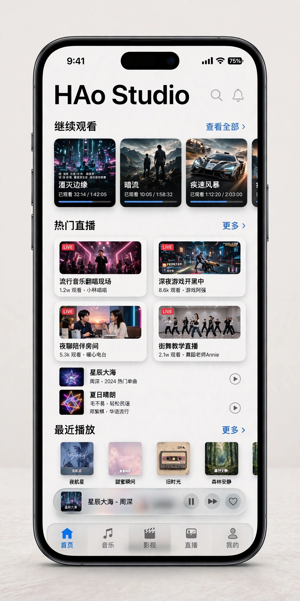
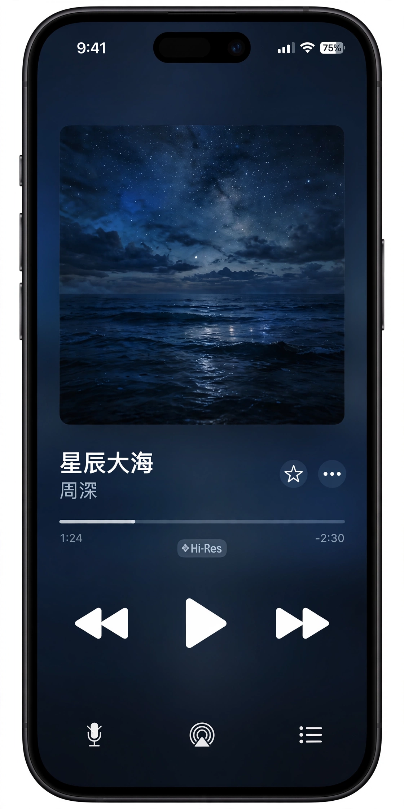
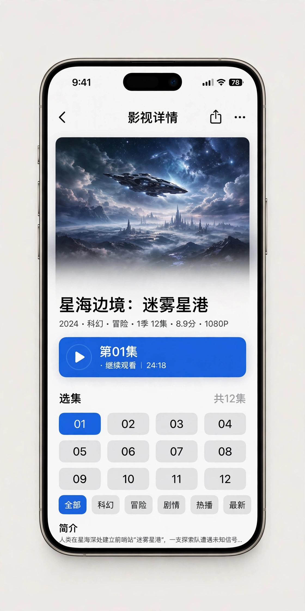
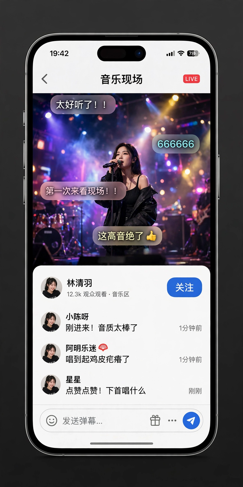

# HAo Studio 独立版


**音乐、影视、直播，三合一的原生 iOS 播放器。**

SwiftUI 全原生重写 · 不登录 · 无商店 · 无社区 · 无后台 · 所有流量走手机直连

> HAo Studio 独立版是一个非官方的开源播放器，与任何音乐、视频、直播平台均无隶属关系。本项目仅供学习交流，请支持正版内容。

## 这是什么

HAo Studio 独立版（2.0）是一个完全自包含的 iOS 应用：音乐、影视、直播三大功能全部原生实现，不依赖任何网站、服务器或账号体系。没有登录界面，没有内购，没有社区，没有后台统计——打开就能用，全部免费。

- **音乐**：AVPlayer 原生播放，LX Music 解析，多平台合并搜索
- **影视**：CMS 源 + Emby 直连，VidHub 风格的浏览与详情页
- **直播**：Bilibili / 斗鱼 / 虎牙 / 抖音 / 快手五大平台，Pure Live 风格
- **我的**：设置、源管理、Emby 配置、文件备份、在线更新

## 界面

以下为界面渲染图，非实机截图；实机截图后续替换。

| 首页 | 音乐播放器 | 影视 | 直播 |
| --- | --- | --- | --- |
|  |  |  |  |

## 功能

### 首页

继续观看、继续听、热门直播、每日推荐、最近播放，五区聚合，全部是真实数据。

### 🎵 音乐

- **原生播放**：AVPlayer 引擎，自动续播断点（每 10 秒 + 进后台保存），跨曲淡入淡出
- **多平台搜索**：网易、QQ、酷狗、酷我合并搜索，网易和 QQ 优先；无限滚动
- **音质**：Master / Hi-Res / 无损 FLAC / 高音质 320k / 标准 128k 五档；只认真实高码率，低码率不会冒充高码率
- **歌词在封面后**：点封面看歌词，点歌词行跳转；不支持逐字卡拉 OK（没有音源返回逐字时间）
- **歌单与收藏**：歌单、收藏、私人漫游、心动模式，全部本地，无需登录
- **播放器**：Apple Music 风格，整页一屏放得下；均衡器；迷你播放器与底栏联动（展开/收起、滚动时自动收起）

### 🎬 影视

- **片源**：CMS 聚合源 + Emby 服务器直连（在设置里填你自己的 Emby 地址和密钥）
- **浏览**：VidHub 风格——影视与 Emby 各有独立浏览页，分类、地区、年份、排序筛选，无限滚动
- **详情页**：顶部是封面大图，没有中间的大播放键；播放靠下面的选集按钮
- **播放**：点播直接横屏全屏；Emby 直连支持 4K HEVC / Dolby Vision / HDR / MKV，TrueHD / DTS-HD 解码为 PCM 输出
- **继续观看**：断点续播；Emby 继续观看、搜索、收藏同步
- **画质**：点播没有画质档位（一集只有一个播放地址，不造假按钮）；画质选择只在直播

### 📺 直播

- **五大平台**：Bilibili、斗鱼、虎牙、抖音、快手（只做这五个，不加别的）
- **Pure Live 风格**：直播间、关注、历史、搜索，全部按 Pure Live 的做法
- **弹幕只收不发**：看得到弹幕，发不出去（没有平台登录）
- **画质 / 线路**：直播间可切画质档位和线路；长按 2 倍速只在点播，直播是实时流，永远不加速

### 🎨 外观与设置

- **4 套主题 × 浅色/深色 = 8 种组合**：苹果毛玻璃、暗夜鎏金、清新薄荷、极夜冰蓝，切换立即全 app 生效
- **底栏玻璃**：玻璃底栏 + 迷你播放器，页面像连在一起
- **设置**：源管理、Emby 配置、备份导出/导入（单个文件，换机可带走全部本地数据）、在线更新、触感反馈开关、底栏选中色自选
- **设计参照**：影视按 VidHub、音乐按 Apple Music、直播按 Pure Live、设置按 iOS 系统设置；全部样式与动态细节对照最新 iOS

## 下载

当前版本 **2.0.0 build 35**（2026-11-24），IPA 13,824,703 字节，md5 `e1022946e350f1605ecb1a796c277c2d`。

- **下载 IPA**：https://chen-hao-shop-production.up.railway.app/HAoStudio-standalone-v2.0.0.ipa
- **系统要求**：iOS 17.0 以上，iPhone / iPad
- **安装**：这是一个未签名 IPA，不会上架 App Store 或 TestFlight。请用 AltStore、SideStore、Sideloadly 或 Xcode 自签安装，也可用 TrollStore、LCSign 安装。

## 在线更新

应用会定期检查更新（有节流，不会每次打开都弹）：先读商店的 `version.json`，失败时读 GitHub 上的兜底地址；有新版时提示，点开后在 Safari 下载新 IPA、重新安装。侧载应用无法静默安装，更新就是重新装一次，歌单、收藏和设置都在，不会丢。

## 自己编译

需要一台 Mac + Xcode 26.2。

```bash
git clone https://github.com/lauranthao/haostudio-standalone-2.0.git
cd haostudio-standalone-2.0/ios
pod install          # 只有一个 pod：IJKMediaFramework（解 FLV 用）
```

然后用 Xcode 26.2 打开 `HAoStudio.xcodeproj` 构建。构建前先跑预检：

```bash
python3 ios/preflight_check.py   # 工程引用、资产、版本对齐等；不代替编译
```

正式打包走 GitHub Actions：工作流 **iOS Unsigned IPA**（`.github/workflows/ios-unsigned.yml`，macOS 26 + Xcode 26.2），在 Actions 页面手动触发 `workflow_dispatch`（push 不自动触发），产物是 `HAoStudio-ipa`。libmpv 在构建时下载，不在仓库里。

## 工程结构

```
ios/
├── HAoStudio.xcodeproj     # 单 target HAoStudio（bundle id com.haostudio.standalone）
├── HAoStudio/              # SwiftUI 源码
│   ├── HAoStudioApp.swift  # @main 入口
│   ├── App/                # 五 tab 导航、玻璃底栏、迷你播放器
│   ├── Features/           # Home / Music / Video / Live / My
│   ├── Playback/           # 播放内核：AVPlayer / MPV（libmpv）/ IJK
│   ├── Services/           # LX 解析引擎（13 个内置脚本）、CMS、Emby、直播
│   ├── Storage/            # 设置 + 本地数据（UserDefaults 与 Documents JSON）
│   ├── Theme/              # 4 套主题 × 浅/深
│   └── Splash/             # 启动动画 #4
├── Tests/                  # 单元测试（GitHub Actions 上跑）
└── preflight_check.py      # 本地预检
docs/                       # 启动动画规格、Flutter 存储映射等
version.json                # 当前版本、更新日志、IPA 地址
```

## 版本历史

| 版本 | Build | 日期 | 说明 |
| --- | --- | --- | --- |
| 2.0.0 | 35 | 2026-11-24 | **当前版本**：修 build 34 反馈的问题（直播打开闪退、直播间顶部黑条、首页卡片重叠、音乐播放器布局、迷你播放器与底栏联动、设置收放）；音乐/影视源按真实播放重测，失效的删掉、换上能用的；全 app bug 大扫除；影视按 VidHub、音乐按 Apple Music、直播按 Pure Live 重做样式 |
| 2.0.0 | 34 | 2026-11-24 | 2.0 首个公开版之后的第一轮修复 |
| 2.0.0 | 33 | 2026-11-23 | Swift 原生重写首版：首页聚合、音乐、影视、直播、我的全部原生 |
| 1.1.6 | 32 | — | Flutter 旧版，已停止维护，由 2.0 取代 |

## 开发中

v2.0.0 build 36 开发中：19 项修复与优化（VOD 手势、VOD 弹幕设置、全 app 性能与 bug 大扫除）。发版前全部做完、验过，再一次性打包。

## 已知限制

- Emby 多音轨 / 多字幕轨切换暂不支持
- VVC / H.266 暂不支持；IJK 引擎不支持 AV1
- 超分开关暂未接通
- 杜比视界 P5 的 MKV 文件在全部内置引擎上颜色异常
- 模拟器构建暂不可用（IJK 只有真机切片）；真机不受影响

## 致谢

参考了以下开源项目的设计与实现（排名不分先后），不代表任何背书：

- [LX Music](https://github.com/lyswhut/lx-music-mobile)（Apache-2.0）——音乐解析与播放逻辑
- [歌一刀 / KMusic](https://github.com/Mac-XK/KMusic)——播放与解析思路
- [Pure Live](https://github.com/liuchuancong/pure_live)——直播与播放器
- [Kumone](https://github.com/missuo/kumone)——界面设计
- VidHub、Apple Music——影视、音乐界面设计参照
- IJKPlayer、mpv（libmpv）——播放内核
- 豆瓣——影视元数据（评分、演职员、海报、简介）

## 许可证

[MIT](LICENSE) © 2026 HAo Studio

## 免责声明

本应用不提供任何音乐、视频、直播内容。所有内容来自用户自己的片源与服务器，或用户自行填入的第三方 API；音源可用性由各平台决定。本项目与网易、QQ、酷狗、酷我、Bilibili、斗鱼、虎牙、抖音、快手、Emby 及豆瓣均无隶属关系。请支持正版内容。
